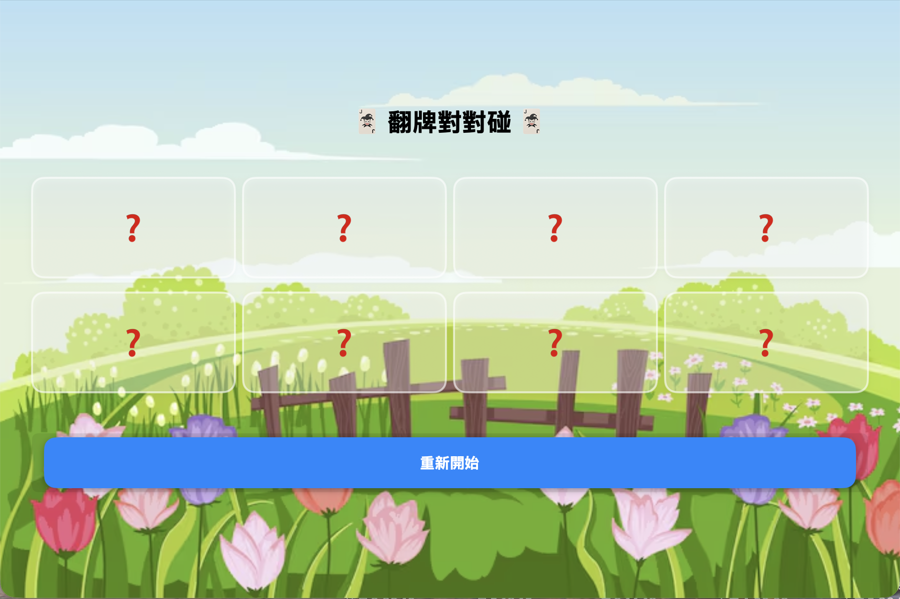
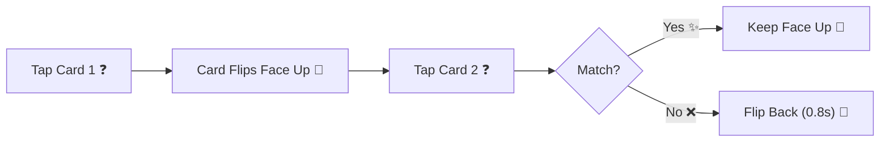
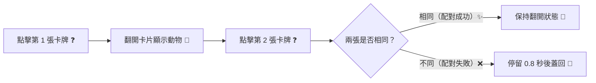

# 🃏 Flip & Match Card Game / 翻牌對對碰

<div align="center">

[](#-english-version)
[](#-繁體中文版)

<br/>

[](https://swift.org)
[](https://developer.apple.com/xcode/swiftui/)
[](https://www.apple.com/ios/)
[](https://developer.apple.com/xcode/)
[](LICENSE)

<br/>

> 🎮 A delightful, responsive memory matching puzzle game developed natively with **SwiftUI**. Test and sharpen your memory by flipping cards to find adorable animal pairs against a vibrant spring meadow landscape!

</div>

---

<a id="-english-version"></a>
<a id="english-version"></a>
## 🇬🇧 English Version

> 🌐 *Switch to Chinese version: [🇹🇼 繁體中文版](#-繁體中文版)*

### 📸 Gameplay Preview

<div align="center">
  
</div>

<br/>

---

### ✨ Features

| Feature | Description |
| :--- | :--- |
| 🧩 **Classic Memory Matching** | Flip two cards at a time to discover matching pairs of animals. |
| 🐾 **Cute Animal Cards** | Features expressive emoji icons: 🐶 Puppy, 🐱 Kitty, 🦊 Fox, and 🐼 Panda. |
| 🎨 **Charming Aesthetic** | Vibrant spring garden illustration backdrop paired with frosted glass card styling. |
| ⚡️ **Debounce & Tap Guard** | Built-in state guard (`isChecking`) prevents erroneous multi-taps during flip animations. |
| 🔄 **Instant Restart** | Re-shuffle cards anytime with a single tap on the **重新開始** (Restart) button. |
| 📱 **Responsive Grid** | Clean 4-column adaptive layout built with SwiftUI's `LazyVGrid`. |

---

### 🎮 Game Rules & How to Play



1. **Start the Game**: 8 cards (4 pairs) are dealt face-down displaying red question marks `?`.
2. **First Flip**: Tap any card to reveal its secret animal emoji.
3. **Second Flip**: Tap a second card to find its twin:
   - **Match Found**: Both cards remain permanently revealed on the board.
   - **Mismatch**: Both cards will automatically flip back face-down after an 0.8-second preview interval.
4. **Win Condition**: Match all 4 pairs to complete the challenge!
5. **Restart**: Tap the bright blue **重新開始** button to shuffle the deck and start a fresh game.

---

### 🛠️ Architecture & Code Overview

The project follows a clean, single-responsibility SwiftUI architecture:

```
Card game/
├── Card game.xcodeproj          # Xcode project configuration
├── Card game/
│   ├── MyApp.swift              # App entry point conforming to SwiftUI App protocol
│   ├── ContentView.swift        # Main game logic, state management, and grid layout
│   └── Assets.xcassets/         # App icons, colors, and spring background artwork
└── screenshots/
    └── screenshot.png           # App screenshot
```

#### Key Components in [`ContentView.swift`](file:///Users/chang/Documents/Card%20game/Card%20game/ContentView.swift)

- **`Card` Model**: Lightweight value type (`Identifiable`, `Equatable`) holding the card's unique ID, emoji content, `isFaceUp` status, and `isMatched` status.
- **`CardView`**: Reusable SwiftUI view component applying frosted translucent rounded rectangles with dual borders and smooth drop shadows.
- **`handleCardTap(at:)`**: Handles game logic, index tracking for comparison, and auto-flip timeouts via `DispatchQueue.main.asyncAfter`.
- **`restartGame()`**: Resets state variables and shuffles the card deck using Swift's native `.shuffled()`.

---

### 🚀 Getting Started

#### Requirements
- macOS 14.0 Sonoma or later
- Xcode 15.0 or later
- iOS 17.0+ Simulator or physical device

#### Installation & Running

1. **Clone the Repository**
   ```bash
   git clone https://github.com/your-username/card-game.git
   cd "Card game"
   ```

2. **Open in Xcode**
   ```bash
   open "Card game.xcodeproj"
   ```

3. **Build & Run**
   - Select your target simulator (e.g., iPhone 15 / iPad / Mac Designed for iPad).
   - Press <kbd>Cmd</kbd> + <kbd>R</kbd> or click the **Play** button in Xcode.

---

### 🧰 Tech Stack

| Technology | Purpose |
| :--- | :--- |
| **Swift 5.9+** | Core programming language |
| **SwiftUI** | Declarative user interface, layout, and animations |
| **Asset Catalog** | High-definition background asset management |
| **Xcode 15+** | Native IDE and simulator test environment |

<br/>

<div align="right">

[⬆️ Back to Top](#-flip--match-card-game--翻牌對對碰)

</div>

---
---

<a id="-繁體中文版"></a>
<a id="繁體中文版"></a>
## 🇹🇼 繁體中文版

> 🌐 *切換至英文版本: [🇬🇧 English Version](#-english-version)*

### 📸 遊戲畫面預覽

<div align="center">
  
</div>

<br/>

---

### ✨ 特色亮點

| 功能特色 | 詳細說明 |
| :--- | :--- |
| 🧩 **經典記憶翻牌** | 每次翻開兩張卡片，考驗並鍛鍊短暫記憶力與專注度。 |
| 🐾 **超萌動物卡牌** | 包含 4 種人氣可愛動物表情符號：🐶 狗狗、🐱 貓咪、🦊 狐狸、🐼 熊貓。 |
| 🎨 **療癒視覺設計** | 搭配手繪春日原野風景背景，卡片採用磨砂玻璃半透明圓角矩形與精緻陰影。 |
| ⚡️ **防誤觸保護機制** | 內建 `isChecking` 狀態鎖定，比對動畫與延遲期間防止玩家連點造成狀態錯亂。 |
| 🔄 **一鍵快速重開** | 隨時點擊底部顯目的「**重新開始**」按鈕，立刻自動隨機洗牌並展開新局。 |
| 📱 **自適應網格排版** | 使用 SwiftUI `LazyVGrid` 打造 4 欄均勻分佈的彈性響應式排版。 |

---

### 🎮 遊戲玩法與規則



1. **進入遊戲**：牌桌上共有 8 張卡片（4 組配對），背面朝上並標示紅色問號 `?`。
2. **翻開第一張**：點擊任意卡牌，查看隱藏的可愛動物圖案。
3. **翻開第二張**：點擊另一張卡牌嘗試配對：
   - **配對成功**：兩張卡牌維持翻開狀態，圖案固定顯示。
   - **配對失敗**：停留 0.8 秒讓玩家記憶卡片位置後，自動翻回背面。
4. **遊戲目標**：找出所有 4 組相同的動物配對即可通關！
5. **重新開始**：點選下方的「**重新開始**」藍色按鈕即可重新洗牌重啟挑戰。

---

### 🛠️ 程式架構與核心實作

專案遵循簡潔直觀的 SwiftUI 開發規範，架構結構如下：

```
Card game/
├── Card game.xcodeproj          # Xcode 專案工程檔
├── Card game/
│   ├── MyApp.swift              # 應用程式進入點 (@main App)
│   ├── ContentView.swift        # 遊戲主畫面、狀態控制邏輯與網格佈局
│   └── Assets.xcassets/         # 圖資庫（春日風景背景圖、AccentColor）
└── screenshots/
    └── screenshot.png           # 遊戲預覽截圖
```

#### 核心元件解析 ([`ContentView.swift`](file:///Users/chang/Documents/Card%20game/Card%20game/ContentView.swift))

- **`Card` 資料模型**：遵循 `Identifiable` 與 `Equatable` 協定，記錄卡片唯一 `id`、圖案內容 `content`、翻開狀態 `isFaceUp` 與配對標記 `isMatched`。
- **`CardView` 卡片元件**：單張卡片視覺視圖，使用 `RoundedRectangle` 搭配白色半透明背景與陰影，呈現卡牌質感。
- **`handleCardTap(at:)` 點擊邏輯**：
  - 驗證點擊合法性（避免重複點擊或比對中點擊）。
  - 比對兩張選定卡片內容，配對成功則標註 `isMatched = true`。
  - 配對失敗時透過 `DispatchQueue.main.asyncAfter` 延遲 0.8 秒蓋回卡片。
- **`restartGame()` 洗牌重置**：調用 Swift 內建 `.shuffled()` 重新打亂卡牌陣列並重置索引與旗標。

---

### 🚀 如何執行專案

#### 環境需求
- macOS 14.0 Sonoma 或以上版本
- Xcode 15.0 或以上版本
- iOS 17.0+ 模擬器或實體 iPhone / iPad 裝置

#### 執行步驟

1. **取得專案原始碼**
   ```bash
   git clone https://github.com/your-username/card-game.git
   cd "Card game"
   ```

2. **以 Xcode 開啟專案**
   ```bash
   open "Card game.xcodeproj"
   ```

3. **編譯並執行**
   - 於頂部選單選擇目標模擬器（例如 iPhone 15 或 iPad Pro）。
   - 按下快捷鍵 <kbd>Cmd</kbd> + <kbd>R</kbd> 或點擊左上角的 **Run** 按鈕即可開始遊玩！

---

### 🧰 技術規格

| 項目 | 使用技術 / 框架 | 說明 |
| :--- | :--- | :--- |
| **程式語言** | Swift 5.9+ | 強型別、現代化語法 |
| **UI 框架** | SwiftUI | 宣告式 UI、響應式狀態驅動視圖 |
| **佈局方式** | `LazyVGrid` & `ZStack` | 4 欄響應式網格與全螢幕風景背景疊層 |
| **非同步排程** | `DispatchQueue` | 控制卡牌配對失敗時的翻轉延遲展示 |
| **開發工具** | Xcode 15+ | 專案建置、模擬器除錯與預覽 |

---

<div align="center">

Made with ❤️ and **SwiftUI**

[⬆️ 回到頂部](#-flip--match-card-game--翻牌對對碰) • [🇬🇧 Switch to English](#-english-version)

</div>
